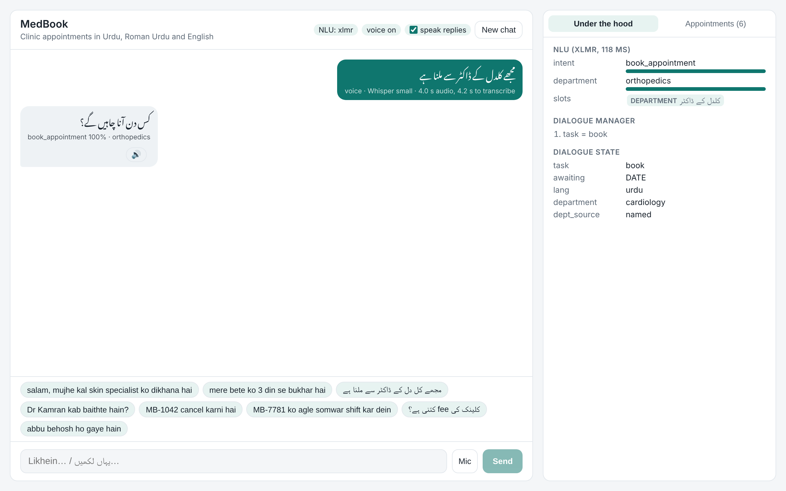

# MedBook chatbot: run the demo

Text chat in Urdu script, Roman Urdu and English, with department routing and real booking, cancel and
reschedule against a SQLite clinic schedule. Optional voice: speak Urdu (Whisper) and hear the answer (MMS-TTS).
For the full stack (PostgreSQL, Redis, Docker, reminders, staff page at `/admin`) see [`DEPLOY.md`](DEPLOY.md).

```
browser (Next.js, :3000) ──/api/*──▶ FastAPI (:8000) ──▶ NLU: XLM-R, or baseline if no weights
                                                     ├─▶ rule layer: emergency, phone, MB-xxxx, doctor names
                                                     ├─▶ dialogue manager (rule-based, per-session state)
                                                     └─▶ SQLite: departments, doctors, duty hours, appointments
```

## 1. Backend (Python 3.10+)

```bash
cd medbook/backend
python -m venv .venv
# Windows: .venv\Scripts\activate      macOS/Linux: source .venv/bin/activate
pip install -r requirements.txt
python clinic_db.py --reset          # builds data/clinic.db with 16 doctors and 6 seed bookings
uvicorn main:app --port 8000
```

The first start trains the baseline NLU from `data/dataset_v2` (about 30 seconds) and caches it in `.cache/`.
Check it is up: http://localhost:8000/api/health shows `"nlu_engine": "baseline"` or `"xlmr"`.

**XLM-R is used automatically.** The backend loads the newest `results/*/model` folder that has weights
(`joint_xlmr.pt`, or `joint_xlmr_fp16.pt.part0`, `part1`, ... as shipped in `results/xlmr_v2/model/` (v2, current) and `results/xlmr_final/model/` (v1)), so you only need
`pip install torch transformers sentencepiece` (the CPU build of torch is enough). Loading takes about 10 seconds and
each message about 30 ms on CPU. The first load downloads the `xlm-roberta-base` config from Hugging Face (internet
once). Point at another folder with `MEDBOOK_MODEL_DIR`, or force the baseline with `MEDBOOK_NLU=baseline`.

**No web UI needed for a quick try:** `python chat_cli.py --debug` chats in the terminal and prints what the
model understood and what the dialogue manager decided.

### LLM mode (optional): let an LLM run the conversation

By default the rule-based dialogue manager (`dialogue.py`) runs, so the demo works offline. Set an API key and an
LLM runs the conversation instead (`llm_agent.py`). XLM-R still parses every message first, and the LLM gets its
intent, department and slots as hints.

```bash
pip install anthropic
export ANTHROPIC_API_KEY=sk-ant-...          # Windows: set ANTHROPIC_API_KEY=...
uvicorn main:app --port 8000                 # /api/health now says "dm": "llm"
python chat_cli.py --debug "mujhe kal skin specialist chahiye"   # shows the tool calls too
```

| Setting | Default | Meaning |
| --- | --- | --- |
| `MEDBOOK_DM` | `auto` | `auto`: LLM if a key is set, else rules. `llm` or `rules` forces one |
| `MEDBOOK_LLM_PROVIDER` | `anthropic` | `openai` = any OpenAI-compatible server (Gemini, Groq, local Ollama) |
| `MEDBOOK_LLM_MODEL` | `claude-haiku-5-5` | about $0.10 / $0.50 per million tokens in / out |
| `MEDBOOK_LLM_EFFORT` | `low` | thinking effort (Claude); low keeps replies fast |
| `MEDBOOK_LLM_BASE_URL`, `MEDBOOK_LLM_API_KEY` | | for `openai`, e.g. `http://localhost:11434/v1` with `qwen2.5:7b` |

What the LLM can and cannot do. It talks to the patient and calls tools: `search_slots`, `list_doctors`,
`find_appointment`, `clinic_info`, `propose_booking` / `propose_cancel` / `propose_reschedule` and `confirm_pending`.
The code keeps these guards, whatever the LLM says:

- An emergency keyword stops the turn before the LLM is called and sends the fixed 1122 reply.
- A booking can only use a `slot_id` that `search_slots` returned in this chat and that is still free.
- Writing is two steps. `propose_*` checks the request (valid phone, booking exists and is not past, same
  department for a reschedule), and the system always shows the user a fixed summary. `confirm_pending` writes only
  if the user's very next message is a yes (same yes/no rules as the rule-based manager, or XLM-R "confirm").
- Any MB-xxxx number in the reply that is not in the database is removed. The real number from the insert is
  always added to the reply.
- If the LLM call fails (no network, quota), the user gets a "try again" reply and the turn is dropped.

The side panel shows the XLM-R output, every tool call with its result, and the guards that fired.
Compare the two managers with `simulate.py --dm llm` and `dm_compare.py` (section 4).

## 2. Frontend (Node 18.18+)

```bash
cd medbook/frontend
npm install
npm run dev                          # http://localhost:3000
```

The Next.js server forwards `/api/*` to `http://127.0.0.1:8000` (change with `BACKEND_URL`), so only
one address is opened in the browser. The right panel shows, for every message: intent and confidence,
department and confidence, slots, the rules that fired, the dialogue manager's decisions and the dialogue state.
The Appointments tab shows the database; new bookings are green, cancelled ones struck through.

## 3. Voice (optional): speak Urdu, hear the answer

```bash
pip install faster-whisper "av<16" soundfile   # av 16+ breaks faster-whisper 1.2 audio decoding
# spoken replies also need torch + transformers, already installed for XLM-R
set MEDBOOK_VOICE_PRELOAD=1          # Windows (macOS/Linux: export ...). Loads both models at startup
uvicorn main:app --port 8000
```

Press **Mic**, speak, press **Stop** (it stops by itself after 30 s). The transcript appears as your message with
the Whisper model and timing under it, the bot answers as usual, and the answer is read aloud. Every Urdu-script bot
message has a 🔊 button, and "speak replies" in the header turns the automatic reading off.
The first run downloads Whisper large-v3-turbo (about 1.6 GB) and the Urdu voice (about 150 MB) once.

How it works (`backend/voice.py`):
- **Speech to text:** faster-whisper, int8 on CPU, language forced to Urdu (`MEDBOOK_WHISPER_LANG=ur`), because
  left to detect it Whisper often writes spoken Urdu in Hindi script, which the NLU cannot read. Spoken Urdu comes
  out in Urdu script, so the dialogue manager answers in Urdu script too.
- **Clinic vocabulary prompt:** a short Urdu prompt with clinic words and the 16 doctor names from the database
  nudges spelling (ڈاکٹر, not داکتر). `MEDBOOK_WHISPER_PROMPT=0` turns it off.
- **Transcript cleanup**, so the existing NLU rules still fire: Urdu digits to 0-9; four or more spoken digits
  ("صفر تین صفر صفر ...") to a number; "ایم بی 1042" to `MB-1042`; a phone number split in groups joined
  up; a misheard doctor name after "ڈاکٹر" snapped to the closest real name ("ڈاکٹر شازی کون" to
  "ڈاکٹر شازیہ کنول"; it changed none of the 4,139 typed Urdu messages in the dataset); Whisper's YouTube-style
  inventions on silence ("سبسکرائب", "دیکھنے کا شکریہ") dropped.
- **Spoken replies:** Meta MMS-TTS for Urdu (`facebook/mms-tts-urd-script_arabic`), offline on CPU, about 0.5 s
  per sentence. Before speaking, numbers become words (`10:30` to "دس بج کر تیس منٹ", `MB-1042` and phone numbers
  digit by digit), and Latin words become Urdu letters. Roman Urdu replies are not spoken, since the voice reads
  only Urdu script. `MEDBOOK_TTS=0` turns it off.
- **API:** `POST /api/voice` (multipart `audio` + `session_id`; webm, ogg, m4a, mp3 or wav) returns the transcript,
  the raw Whisper text and timing, plus everything `/api/chat` returns. `POST /api/tts {text}` returns `audio/wav`.



### How well it hears (`voice_eval.py`)

Three test sets. **FLEURS** is 100 clips of real people reading Urdu sentences (Google's FLEURS `ur_pk` test
split): real voices, but news-style text. **Synthetic clinic** is 150 held-out Urdu-script messages from the dataset
(42 free-form + 108 test-template rows, every intent) spoken by the MMS voice, clean and with room noise at 10 dB
SNR. Because these are labelled, we can also check what matters for the bot: does the NLU (XLM-R + rules + keyword
routing, exactly as the dialogue manager uses them) still get the intent and the department from the transcript?
Typed, the same 150 messages score 94.7% intent and 97.9% department (47 routed messages). WER and CER are computed
after removing punctuation and diacritics, unifying letter variants and writing digits as words. Speed is on a
4-core cloud CPU, no GPU.

| Whisper (int8, CPU) | FLEURS real speech WER | CER | Clinic clips WER | Intent from voice | Department from voice | Emergencies caught | Seconds per clinic message |
| --- | --- | --- | --- | --- | --- | --- | --- |
| tiny | 65.5% | 30.0% | 61.5% | 61.3% | 40.4% | 11/12 | 1.0 |
| base | 50.3% | 21.6% | 52.7% | 65.3% | 51.1% | 11/12 | 1.2 |
| small | 37.2% | 14.7% | 38.4% | 72.7% | 51.1% | 11/12 | 3.8 |
| medium | 28.2% | 11.1% | 26.7% | 78.0% | 63.8% | 12/12 | 5.8 |
| **large-v3-turbo (default)** | **21.4%** | **7.9%** | 29.4% | 78.0% | 70.2% | **12/12** | 5.1 |
| large-v3-turbo + doctor names and name snapping (as the app runs) | | | 29.8% | **78.7%** | **76.6%** | **12/12** | 5.5 |

| Same, with room noise (10 dB SNR) | Clinic clips WER | Intent from voice | Department from voice | Emergencies caught |
| --- | --- | --- | --- | --- |
| tiny | 86.0% | 32.0% | 21.3% | 9/12 |
| base | 68.0% | 44.7% | 38.3% | 10/12 |
| small | 50.5% | 71.3% | 44.7% | 11/12 |
| large-v3-turbo, as the app runs | 41.2% | 74.7% | 59.6% | 12/12 |

The clinic-vocabulary prompt on small: WER 41.0% without, 38.4% with. Adding doctor names and snapping on small:
intent 72.7% to 76.7%, department 51.1% to 61.7%.

What this shows:
- **large-v3-turbo is the right default.** On real speech it makes 42% fewer word errors than small and 24% fewer
  than medium, at about the same speed as medium. On a weak laptop use `MEDBOOK_WHISPER=small` (about 4 s per message,
  much less memory); tiny and base are not usable for Urdu.
- **Emergencies survive voice.** Every spoken emergency in the set still triggered the 1122 advice with
  large-v3-turbo, clean and noisy, because the emergency keywords are short, common words that Whisper gets right.
- **Department routing suffers most** (97.9% typed, 76.6% spoken). Most failures are one misheard symptom word
  (پیٹ heard as پیپ, جلد as ڈیڑھ, حمل as ہمیل). The bot is still safe here: a weak department goes to the
  General Physician, and the user sees the transcript and can correct it.
- **Synthetic numbers are a pessimistic bound for clean speech but not proof.** The MMS voice is robotic and
  slurs words together (کل دل heard as کلدل), which a person would not do; on the FLEURS real voices large-v3-turbo
  does far better (21% WER) than on the synthetic clips (30%). Real patients will also speak Roman-Urdu-style
  sentences with English words, which neither set covers.
- **The honest test is your own recordings.** `data/voice_recordings/refs.tsv` lists 30 clinic sentences with labels
  (every intent, numbers, booking numbers, doctor names). Record them on a phone from 5 to 10 people, put the files
  next to `refs.tsv`, and run `python voice_eval.py --set recordings --dir ../data/voice_recordings --models large-v3-turbo small`.

```bash
cd medbook/backend
python voice_eval.py --build                                  # rebuild the 150 synthetic clips (data/voice_eval_v1/)
python voice_eval.py --set synthetic --models large-v3-turbo small --doctors    # clean + 10 dB noise
python voice_eval.py --set fleurs --n 100 --models large-v3-turbo small --prompt off   # downloads 150 MB once
```

Results go to `results/voice_eval/`: `synthetic.json` and `fleurs.json` with every run, and one
`*_transcripts.jsonl` per run with each reference next to what Whisper heard.
Full results on this machine took about 3 hours of CPU; one model on one set takes 10 to 25 minutes.

## 4. Tests and evaluation

```bash
cd medbook/backend
python -m pytest -q                  # all tests (71 dialogue/parsing + deployment tests, see DEPLOY.md): date/time parsing, full dialogues, safety rules (pass with both engines)
python simulate.py --n 300           # simulated users, openers from held-out test templates
python simulate.py --n 300 --freeform   # openers from the free-form set (harder)
python emergency_check.py            # 1122 recall and false alarms on held-out messages
python route_eval.py                 # department routing accuracy: model only vs model + keyword backstop
```

### Department routing (`route_eval.py`)

Routing is decided as the dialogue manager does it: doctor name, then department name, then the symptom. The
symptom step now combines the model with a keyword backstop (`routing.py`): organ and complaint words in Urdu script,
Roman Urdu and English, plus an age rule for children. It was added because XLM-R sent natural Urdu-script symptoms to
the wrong department with full confidence (for example "گلے میں درد ہے اور بخار" went to cardiology; it now goes to ENT).

| XLM-R department accuracy | Model only | Model + keywords |
| --- | --- | --- |
| Free-form, all (56 routed messages) | 91.1% | **98.2%** |
| Free-form, Urdu script (19) | 84.2% | **94.7%** |
| Free-form, Roman Urdu (25) | 92.0% | **100%** |
| Free-form, mixed (12) | 100% | 100% |
| Test templates, clean labels (394) | 99.5% | **100%** |
| Validation templates (360) | 100% | 100% |

On free-form messages the keywords changed 4 answers and all 4 were fixes. With the baseline NLU they changed 6, with
5 fixes and 1 new error.

**Dataset bug found on the way.** Templates of the form "{CHILD} ki umar {AGE} hai" draw any age from the lexicon,
so rows like "my younger brother, age 45" are labelled pediatrics: 46 train rows (templates boo_r22, boo_u13, boo_m10,
des_r13) and 26 test rows (des_u08, des_m07). The age rule routes a stated adult age away from pediatrics, so on the raw
test labels accuracy shows 93.8%; leaving those 26 rows out gives 100%. Fix the generator so a CHILD phrase only gets an
age of 12 or under (`data_gen/generate.py`), and regenerate before the final training run.

**Caveat for the report.** I had seen some free-form failures before writing the keyword lists, so the free-form gain is
optimistic. The 100 to 200 real messages you collect are the fair test of this fix.

### Whole dialogues (`simulate.py`)

`simulate.py` plays a cooperative user with a goal (book 70%, cancel 15%, reschedule 15%) and judges
success in the database, not in the bot's words. There are 300 dialogues per line, seed 7, and both engines use the same
dialogue manager. "Before" is the dialogue manager without the keyword backstop, scored on raw labels. "After" is the current one.

| Openers | NLU | Task success, before | Task success, after | Booking, before | Booking, after | Urdu-script dialogues, after | Invented booking numbers |
| --- | --- | --- | --- | --- | --- | --- | --- |
| Free-form messages | Baseline | 85.0% | 97.3% | 80.1% | 96.4% | 100% | 0 |
| Free-form messages | **XLM-R** | 94.0% | **99.7%** | 91.5% | **99.5%** | 98.6% | 0 |
| Test templates, clean labels | Baseline | 99.3% | 100% | 99.1% | 100% | 100% | 0 |
| Test templates, clean labels | XLM-R | 98.7% | 100% | 98.0% | 100% | 100% | 0 |

The template lines leave out openers with the adult-labelled-pediatrics bug (18 to 21 of 300). On raw labels they score 93 to 94%,
and every failure is one of those rows. Read all of this with care. The simulated user answers in template language and
always cooperates, and the free-form openers are drawn with repetition from 145 messages. These are upper bounds that show the
parts work together, not a measure of real-patient success.

Safety (`emergency_check.py`, unchanged by the routing fix): every held-out emergency message gets the 1122 advice with
XLM-R (37/37 template, 8/8 free-form), while the baseline misses 1 of 8 free-form ones. False alarms on free-form
non-emergencies are 3.6% with XLM-R and 0.7% with the baseline. Failed dialogues are saved next to the scores
(`results/dialogue_sim/*_failures.jsonl`), and every routing change is listed in `results/dialogue_sim/routing_*.json`.

**Model-only emergencies.** When the keyword rules fire (behosh, saans nahi aa rahi, zeher, ...) the bot stops
everything and sends the user to 1122. When only the model says emergency, the bot still gives the 1122 advice first,
then offers a booking with the routed department in case it is not urgent. Without this, XLM-R's false alarms
(for example "khana hazam nahi hota") were dead ends.

### Rule-based vs LLM dialogue manager (`simulate.py --dm llm`, `dm_compare.py`)

The same simulated users (same seed, openers and answers) talk to the LLM manager, and success is again checked in
the database. The LLM tells the simulator what it is waiting for through the `awaiting` field of its JSON reply.
`simulate.py` also records turn time, LLM calls and tokens, and the cost per 1000 dialogues.

```bash
python simulate.py --n 300 --dm llm              # about $1 on Haiku 5.5
python simulate.py --n 300 --dm llm --freeform
python dm_compare.py                             # table in ../results/dialogue_sim/llm_vs_rules.md
```

Note for the report: this simulated user was written for the rule manager (it answers exactly what was asked, in
template language), so it is an easy test for both. The LLM's advantage is expected on messages the rules
did not plan for (several requests in one message, changing your mind, side questions), which the simulator
does not produce. Try those by hand in the demo and save the transcripts.

## 5. A 5-minute script for the mid evaluation

1. `salam, mujhe kal skin specialist ko dikhana hai` → `subah` → `2` → `Ali Raza` → `0300-1234567` → `ji haan`.
   Booking appears in the Appointments tab with its MB number.
2. New chat: `mere bete ko 3 din se bukhar hai`. Routed to Pediatrics from the symptom and the word "bete".
3. New chat, Urdu script: `مجھے کل دل کے ڈاکٹر سے ملنا ہے` → `صبح دس بجے` → `میرا نام فاطمہ نور ہے` →
   `03211234567` → correct it at the confirmation: `نہیں، پرسوں کر دیں` → `جی ہاں`.
4. `MB-1042 cancel karni hai` → `haan`. Then `MB-7781 ko reschedule karna hai` → `agle somwar` → `subah` → `1` → `haan`.
5. `Dr Kamran kab baithte hain?` (answered from the duty table, with the next free slot).
6. Mid-booking, type `abbu behosh ho gaye hain`: the task is dropped and the user is sent to 1122.
7. Ask for a Sunday (`29 tareekh`): the bot says the clinic is closed and offers real alternatives.

Seed bookings for the demo: MB-1042, MB-2210, MB-0087, MB-3315, MB-4521, MB-7781 (dates are set relative to the
day the database is built). `python clinic_db.py --reset` restores them.

## How the dialogue manager decides (for the report)

- **Slots and order.** Booking needs department (or doctor), date, time, then patient name and phone. Availability
  is checked before asking for personal details, so nobody types their number for a slot that does not exist.
- **Routing.** Explicit doctor > named department (lexicon match) > symptom. For the symptom, organ/complaint keywords
  and a stated age (12 or under means pediatrics) decide when they point to one department; otherwise the model's
  department head decides, and below 0.40 confidence the bot routes to General Physician and says why.
- **Dates and times** (`normalize.py`): kal, parson, agle somwar, 25 tareekh, دو دسمبر, saade 9, paune 6,
  4 baje ke baad, Zuhr ke baad, shaam 6 se 7 ke beech. Hours 1 to 7 without am/pm mean pm (clinic hours).
- **No invented bookings.** Offers come only from free slots in the database, booking numbers only from inserts,
  and nothing is written without a "yes" to a summary. A unique index stops two sessions taking one slot.
- **Corrections.** Any slot can be changed at any time (`nahi, parson`, `time badal dein`) and the plan is rebuilt.
- **Rules on top of the model** (all logged in the trace): emergency keywords; a short ordinal ("1", "pehla wala") picks an offered slot even if the model tagged it as a date; phone and MB-xxxx regex; doctor
  names from the database; short yes/no words at a yes/no question; cancel keywords; a stray "no" with nothing
  pending is re-read as a symptom when the department head is confident (0.60+); a weak task switch (under 0.75)
  in the middle of a task is ignored.
- **Replies** follow the user's script: mostly Urdu script gets Urdu, everything else gets Roman Urdu.

Files: `backend/normalize.py` (dates/times), `clinic_db.py` (schedule and bookings), `nlu.py` (engines and rules),
`routing.py` (symptom keywords), `dialogue.py` (dialogue manager), `replies.py` (all bot text), `main.py` (API), `voice.py` (speech in and out), `simulate.py`, `route_eval.py`, `emergency_check.py` and `voice_eval.py` (evaluation),
`frontend/app/page.tsx` (UI). Clinic address, phone and fees in `replies.py` / `clinic_db.py` are demo values.
